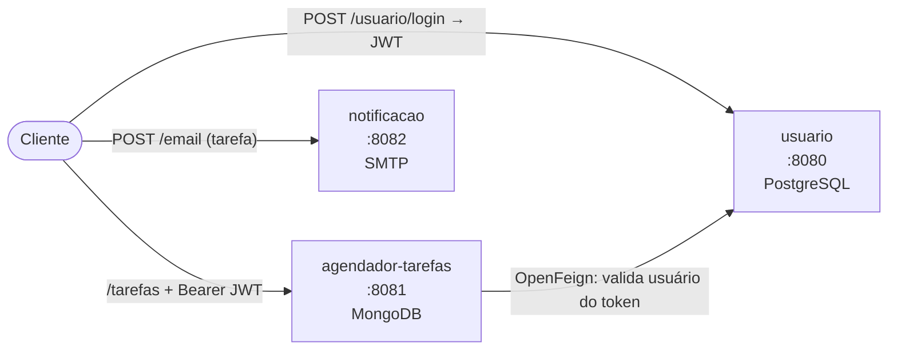

# 📅 Agendador de Tarefas — Microsserviço

Microsserviço para **criar, consultar e gerenciar tarefas agendadas** de cada usuário, com controle do status de notificação. Autentica com JWT e se comunica com o serviço de usuários via **OpenFeign**.


## ✨ Funcionalidades

- CRUD de tarefas vinculadas ao usuário dono do token
- Busca de tarefas por **período** (data inicial e final do evento)
- Atualização do **status de notificação** (`PENDENTE`, `NOTIFICADO`, `CANCELADO`)
- Validação do usuário no microsserviço `usuario` via **OpenFeign**
- Mapeamento entidade ↔ DTO com **MapStruct**
- Pipeline de **CI no GitHub Actions**

## 🧱 Stack

Java 17 · Spring Boot 4 (Web MVC, Data MongoDB, Security) · Spring Cloud OpenFeign · MapStruct · JJWT · Lombok · Gradle · GitHub Actions

## 🏗️ Estrutura

```
src/main/java/com/eduardoamorim/agendadortarefas/
├── controller/        # endpoints REST
├── business/          # regras de negócio, DTOs e mappers (MapStruct)
└── infrastructure/
    ├── client/        # UsuarioClient (OpenFeign)
    ├── entity/        # TarefasEntity (MongoDB)
    ├── repository/    # Spring Data MongoDB
    ├── security/      # filtro JWT e Spring Security
    └── enums/         # StatusNotificacaoEnum
```

## 🧩 Arquitetura do sistema

Este repositório faz parte de um **sistema de agendamento de tarefas com notificação por e-mail**, dividido em 3 microsserviços Spring Boot:

| Serviço | Porta | Banco | Responsabilidade |
|---|---|---|---|
| [usuario](https://github.com/EduardoAmorimGit/usuario) | 8080 | PostgreSQL | Cadastro de usuários, endereços e telefones; login e emissão de JWT |
| [agendador-tarefas](https://github.com/EduardoAmorimGit/agendador-tarefas) | 8081 | MongoDB | CRUD de tarefas do usuário e controle do status de notificação |
| [notificacao](https://github.com/EduardoAmorimGit/notificacao) | 8082 | — | Envio de e-mail HTML (Thymeleaf + SMTP) avisando sobre a tarefa |



1. O usuário se cadastra e faz login no serviço **usuario**, que devolve um token JWT.
2. Com o token, ele cria e gerencia tarefas no **agendador-tarefas**. O agendador lê o e-mail do token e confirma o usuário no serviço **usuario** via **OpenFeign**.
3. O serviço **notificacao** recebe os dados de uma tarefa e envia um e-mail de lembrete. Status das tarefas: `PENDENTE`, `NOTIFICADO`, `CANCELADO`.

## 🚀 Como rodar

Pré-requisitos: Java 17, MongoDB em `localhost:27017` e o serviço [usuario](https://github.com/EduardoAmorimGit/usuario) rodando na porta 8080.

```bash
./gradlew bootRun
```

A API sobe em `http://localhost:8081`.

## 📡 Endpoints

Todas as rotas exigem o header `Authorization: Bearer <token>` (obtido no login do serviço `usuario`).

| Método | Rota | Descrição |
|---|---|---|
| POST | `/tarefas` | Cria tarefa para o usuário do token |
| GET | `/tarefas` | Lista as tarefas do usuário do token |
| GET | `/tarefas/eventos?dataInicial=&dataFinal=` | Lista tarefas com evento no período (ISO date-time) |
| PUT | `/tarefas?id=` | Atualiza tarefa |
| PATCH | `/tarefas?id=&status=` | Altera status de notificação |
| DELETE | `/tarefas?id=` | Remove tarefa |

**Exemplo — criar tarefa**

```bash
curl -X POST http://localhost:8081/tarefas \
  -H "Authorization: Bearer <token>" -H "Content-Type: application/json" \
  -d '{"nomeTarefa":"Consulta médica","descricao":"Levar exames","dataEvento":"01-12-2026 09:00:00"}'
```

## 🗺️ Próximos passos

- [ ] Rotina agendada que busca tarefas próximas e aciona o serviço de notificação
- [ ] Testes unitários e de integração
- [ ] Docker Compose para subir os 3 serviços juntos
- [ ] Documentação com Swagger/OpenAPI

---

Desenvolvido por **Eduardo Amorim** · [LinkedIn](https://www.linkedin.com/in/eduardosiamorim)
